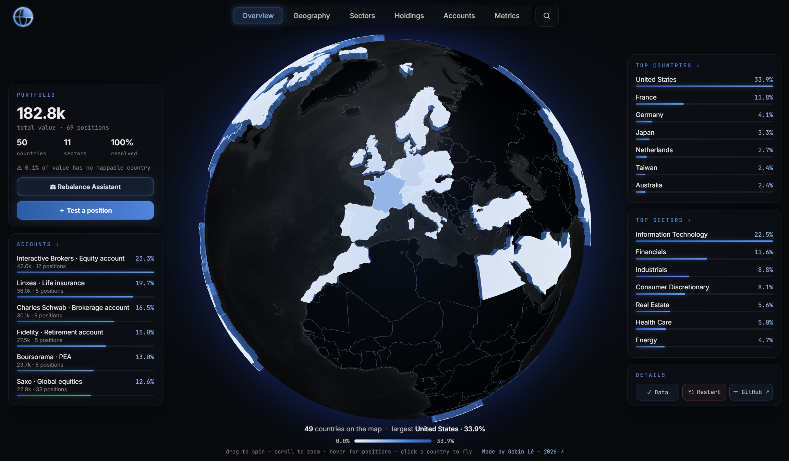

<div align="center">


# PortfolioScan

**See where your money really lives.**

Upload the exports of your brokers and insurers. Every stock, ETF, bond fund, SCPI, euro fund and cash line is
mapped by **country, sector, asset class and account** on an interactive 3D globe, with a clear record of where each
piece of data comes from.


[Quick start](#quick-start) · [Features](#features) · [How it works](#how-each-position-is-analysed) ·
[Run locally](#run-locally) · [Privacy](#privacy)

<br>



</div>

---

## Features

- **Any broker, several files at once.** CSV or Excel exports are read as they are: separator, sheet, header row and
  columns are detected for you, then confirmed in a review window.
- **Look-through analysis.** ETFs are broken down into the countries and sectors they actually hold, from the
  issuers' published data for 2,600+ funds.
- **A 3D globe** coloured by your exposure, with live inspectors: hover a country, sector or region to see which
  positions put you there.
- **Six focused tabs**: Overview, Geography, Sectors, Holdings, Accounts and Metrics.
- **Search everything** from one box: positions, countries, sectors, accounts, metrics and actions.
- **Rebalance Assistant**: what to buy with your next contribution, line by line, to reach a target allocation.
- **Portfolio metrics**: diversification, concentration, home bias, currency exposure, tilt against the world index,
  fund fees, P/E, dividend income.
- **Full transparency**: every value is tagged with its source, every gap is listed, and any position can be corrected
  by hand.

---

## Contents

1. [Quick start](#quick-start)
2. [Importing your files](#importing-your-files)
3. [How each position is analysed](#how-each-position-is-analysed)
4. [Using the app](#using-the-app)
5. [Rebalance Assistant](#rebalance-assistant)
6. [Metrics](#metrics)
7. [Data issues and manual corrections](#data-issues-and-manual-corrections)
8. [Testing a position](#testing-a-position)
9. [Demo portfolio](#demo-portfolio)
10. [Privacy](#privacy)
11. [Limitations](#limitations)
12. [Run locally](#run-locally) · [Deploy](#deploy-on-streamlit-community-cloud) ·
    [Project layout](#project-layout) · [Refreshing the data](#refreshing-the-data) · [Credits](#credits)

---

## Quick start

1. Drop one or more exports on the landing page and click **▶ Analyse N files**.
2. For each file, check the columns the app detected, correct them if needed, and click **✓ Confirm this file**.
3. The scan runs, only for the stocks the embedded data does not already cover. The loading screen then shows three
   key figures (total value, number of positions and analysis precision) before opening the dashboard.

No file at hand? Click **▶ Explore a demo portfolio**.

---

## Importing your files

### Accepted files

`.csv`, `.txt`, `.xlsx` and `.xls`, up to 5 MB each, as many files as you like. Each file is reviewed on its own,
then all of them are merged into one portfolio: the same ISIN held in several files is summed.

### What is detected automatically

| What | How |
|------|-----|
| Separator (CSV) | Comma, semicolon, tab or pipe, guessed from the first lines |
| Sheet (Excel) | The sheet with the most positions |
| Header row | The nearest all-text row above the first ISIN, so title lines on top are skipped |
| ISIN / code column | The column with the most ISINs or recognised codes |
| Value column | By header ("Montant en EUR", "Valorisation", "Market value", "Value"…), never a price, quantity, cost, gain or performance column; otherwise the numeric column with the largest total |
| Name column | A name-like header ("Produit", "Nom", "Libellé", "Name"…), then the most varied text column |
| Account column | A header such as "N° Contrat", "Compte", "Account", "Portfolio", with few distinct values |
| Account label | A column constant within each account (e.g. the product name), put in front of the account number |

Numbers are read in any common format: `3 561,18 €`, `1,234.56`, `1.234,56`, `- 111,61`. Lines that Degiro wraps
entirely in quotes are unwrapped.

### The review window

For every file, **Check the import** shows:

- the separator or sheet, the header row and the ISIN, value, name and account columns, each in a menu you can change;
- an **account name**, used for every line when the file has no account column (the file name by default);
- a preview of the file with the chosen columns highlighted;
- the positions recognised, the accounts found with their totals, and the ignored rows with the reason.

Buttons: **Confirm this file**, **Skip file**, **Cancel**.

### Lines without an ISIN

| Line | Recognised from |
|------|-----------------|
| Cash | Code `CASH…` / `LIQUIDIT…` / `ESPECES…`, or a name containing "cash", "liquidités", "espèces" |
| Euro fund | Codes such as `SUR000001730`, `FONDSEURNG`, `NETIS075`, or a name like "Fonds en euros…" |
| SCPI | Code `SCPI…`, or a name starting with "SCPI" |

A line with a real ISIN is never reclassified from its name (a money-market ETF called "… Cash" stays an ETF).

The simplest possible file is two columns, ISIN then value:

| A · ISIN     | B · Value |
|--------------|-----------|
| US0378331005 | 12 000    |
| FR0000121014 | 7 000     |

---

## How each position is analysed

### Stocks

Name, country and sector are looked up in a cascade, each source filling only what the previous one missed:

1. **FinanceDatabase**, embedded as a snapshot (45,000+ ISINs), so most stocks resolve instantly and offline;
2. **Yahoo Finance** (yfinance), by ISIN;
3. **OpenFIGI**, by ISIN, with the sector matched back by company name in FinanceDatabase;
4. as a last resort for the country, the ISIN's country prefix (shown as an estimate).

ADRs (e.g. ARM, Infosys) get the company's country, not the United States.

### ETFs from the snapshot (2,600+ funds)

iShares, SPDR, Amundi and Xtrackers ETFs come with their real country and sector breakdown, computed from the
issuers' published fund data (every holding summed by country and by sector). Each ETF keeps its **10 largest
countries and 10 largest sectors**; the rest is grouped as **Other**, and holdings the issuer did not classify are
**Unknown**.

- Synthetic (swap) ETFs hold a collateral basket unrelated to what they track, so their breakdown is the one of the
  **index** they replicate.
- Sector names are normalised to the 11 GICS sectors.
- An ETF is spread over its countries and sectors: totals per country and per sector are exact, how they pair up
  inside the fund is approximated.

### Other ETFs: Yahoo Finance estimate

An ETF missing from the snapshot is looked up on Yahoo Finance, trying each of its listings until one has fund data.

- **Sectors**: the fund's own sector weights, complete.
- **Countries**: Yahoo has no country breakdown. A fund named after a single country ("MSCI Japan", "Switzerland")
  is that country at 100%. Otherwise the countries of its top 10 holdings are used and the rest of the fund is
  Unknown.

An ETF with no fund data anywhere is excluded and listed under **Data issues**.

### Bonds, SCPI, euro funds and cash

| Type | Country | Sector | Asset class |
|------|---------|--------|-------------|
| Bond ETF | The issuers' countries | "Bonds" (GICS sectors describe companies) | Bonds |
| SCPI | France (a SCPI is a French vehicle) | Real Estate | Real estate (SCPI) |
| Euro fund, cash | None by nature | None by nature | Euro funds & cash |

### Grey lines

**Unknown**, **Other (outside top 10)**, **Bonds**, **Euro funds & cash** and an ETF's own **Cash & Derivatives**
are not real countries or sectors. They are shown in grey at the bottom of every list, never on the globe, and are not
counted in the number of countries and sectors.

### Analysis precision

The precision shown after the scan is the share of the portfolio's total value (excluded funds included) whose
country **and** sector are both known.

---

## Using the app

### Tabs

The tab bar at the top switches between six views. The active tab is kept when the app refreshes (after a correction
or a test position, for instance).

| Tab | What it shows |
|-----|---------------|
| **Overview** | The globe, coloured by the weight of each country, with the summary cards around it |
| **Geography** | Bar charts of every country and region, with a search box. Hover a bar for its positions, click it to list them |
| **Sectors** | A treemap of sectors and the positions inside each; click a sector to zoom in |
| **Holdings** | The asset classes at the top, then every position with name, ISIN, ticker, country, sector, value, weight and sources. Filter, sort by any column, **Export CSV** |
| **Accounts** | Each account with its value, share, asset classes, top countries, top sectors and positions. Click a country or sector to list that account's positions in it |
| **Metrics** | Diversification, costs, valuation and income of the whole portfolio ([details](#metrics)) |
| **Simulation** | Only with test positions: how they shift the sector and country weights |

### The overview

- **Portfolio** card: total value, positions, countries, sectors, share resolved and notes (excluded ETFs, value with
  no mappable country), with the **Rebalance Assistant** and **＋ Test a position** buttons.
- **Accounts** card: value, share and number of positions of each account. Click one to open it.
- **Top countries** and **Top sectors**: hover a row for its positions; click a country to fly the globe there; click a
  title to open the matching tab.
- **Simulation** card (with test positions only): edit or remove each one and see the largest shifts.
- **Details**: **Data** (issues, scan log and data sources), **⟲ Restart** (back to the upload page) and **GitHub**.
- **On the globe**: drag to spin, scroll to zoom, hover a country to list its positions, click to fly to it.

### Search

The **magnifier** to the right of the tabs opens a search box. Press **/** or **Ctrl K** from anywhere to open it.

| Type | What happens |
|------|--------------|
| Positions, by name, ISIN, ticker, country, sector or asset class | Opens **Holdings**, filtered on that position |
| Countries, regions, sectors | Lists every position exposed to it |
| Accounts | Opens that account in **Accounts** |
| Asset classes | Opens **Holdings**, filtered on that class |
| Metrics (diversification, home bias, fees, P/E, dividends…) | Opens **Metrics** and highlights that card |
| Tabs and actions (Rebalance Assistant, Test a position, Data issues, Data sources, Scan log, Export CSV, GitHub, Restart) | Runs it. Restart asks for confirmation |

Results are ranked by relevance with the matching letters highlighted. Accents are ignored and common French terms
work too ("frais", "pays", "rééquilibrer"…). Use **↑ ↓** to move, **↵** to open and **Esc** to close.

### Data sources

Every value in **Data → Data sources** carries a tag: *Database* (FinanceDatabase, OpenFIGI), *Issuer data*,
*Yahoo Finance*, *Estimate* (with what it was estimated from), *Manual*, *Your file* or *Not found*.

---

## Rebalance Assistant

Set a target allocation and an amount to invest. The assistant tells you exactly what to buy, line by line, to get
closer to it **without selling anything** (selling is an option you switch on).

- **Targets** mix freely: countries, regions, sectors and asset classes, for example 55% United States, 15% Europe,
  12% Information Technology. **Start from my current** fills a dimension with today's top categories at their exact
  weights, ready to edit. Categories are measured through your funds (an ETF counts for each country and sector it
  holds).
- **The plan** lists each line to buy (or sell) with its amount, its weight before and after, and the targets it
  helps. **Export plan (CSV)** and **Copy** give you the list to place your orders.
- **Options**: trade in at most N lines, round amounts to 10 / 50 / 100, leave out the lines you do not want to touch,
  enter your trading fees (fixed, percent, minimum), and allow selling overweight lines. Selling is only proposed when
  a target is off by more than half a point.
- **Insights**: the average gap to your targets before and after; how much you would need to invest for buying alone
  to fix an overweight; how selling would compare; the number of months of the same contribution to get within one
  point of every target (markets assumed flat); and a warning when none of your lines gives exposure to a target.
- **How it works**: the plan minimises the squared gap between each target and the portfolio's weight after the
  trade. It is solved in your browser, so it updates as you type, and your targets are remembered there.

---

## Metrics

The **Metrics** tab measures the portfolio as a whole. Funds are looked through, so an ETF counts for each country and
sector it holds. Every figure has an ⓘ with its definition, and every figure built from incomplete data states how
much of the portfolio it covers.

**Diversification**

- **Geographic and sector diversification**: the Herfindahl-Hirschman index (sum of squared weights, out of 10,000)
  and the *effective number* of countries or sectors (1 / HHI), next to the same figure for the world index
  (MSCI ACWI). Unknown and cash are left out.
- **Position concentration**: largest line, top 5, top 10 and effective number of positions.
- **Home bias**: your weight in a country of your choice (France by default) against the world index.
- **Emerging markets** and **currency exposure** (by the underlying country, not the fund's trading currency).
- **Tilt against the world index**: largest over- and underweights by country and sector, and the active share.
- **Funds that may overlap**: pairs of funds with a near-identical country and sector breakdown. A hint only, since
  the data has no individual stocks.

**Costs**

- **Fund fees**: weighted annual fee (TER) of your ETFs and funds, the yearly amount, and the lines that cost most.

**Valuation and income**

- **P/E** (trailing and forward), **dividend income** and yield, and **company size**. The P/E is averaged the
  harmonic way (total price over total earnings); loss-making companies and impossible values are left out.

**Where the numbers come from.** Stocks: Yahoo Finance, looked up when the results open (about 8 at a time, cached for
a day). ETFs: `data/etf_costs.csv.gz` (annual fee from Amundi's data and Yahoo, P/E and yield from Yahoo), or Yahoo
directly for an ETF outside the snapshot. Stocks have no fund fee; SCPI and euro funds have fees that are not
published, so they are listed as missing.

---

## Data issues and manual corrections

**Data → Issues** lists every missing or guessed piece of data, sorted by weight, with a summary such as
"3 issues · 2.8% of the portfolio affected":

- ETFs and funds with no data at all, and why;
- stocks not identified, or missing a country or a sector;
- countries guessed from the ISIN prefix, or not found on the map;
- ETFs with 5% or more of the fund without a country or sector.

**✎ Fix** opens an editor prefilled with the position's current breakdown: one line per country and per sector with a
percentage, suggestions while typing, and lines to add or remove. **Save correction** replaces what was found
everywhere in the app (each list is rescaled to 100%) and also brings an excluded ETF back into the portfolio.
Corrections are listed under **Manual corrections** with **Edit** and **Reset**, are tagged *Manual* in Data sources,
and last for the session.

---

## Testing a position

**＋ Test a position**: enter an ISIN and a value. An ETF from the snapshot is added at once; any other ISIN is scanned
first and added if it resolves to a stock or a Yahoo-estimated ETF. Test positions go into a "Simulation" account and
show in the Simulation card and tab, where they can be edited or removed.

---

## Demo portfolio

About 183k spread over six accounts: Interactive Brokers, Boursorama (PEA), Fidelity, Linxea (life insurance),
Charles Schwab and Saxo. It holds world, emerging, US, Europe, Pacific, Latin America, quality, water, property and
small-cap ETFs, two bond ETFs, around fifty stocks from every region, a SCPI, a euro fund and cash. It covers 50
countries and all 11 sectors, and opens instantly because its lookups are pre-computed.

---

## Privacy

Uploaded files stay in the memory of your session: nothing is written to disk or kept after the session ends. For a
stock or ETF the embedded data does not cover, only its ISIN (or a fund ticker) is sent to Yahoo Finance or OpenFIGI;
values, names and accounts never leave the app. Rebalance targets and trading fees are stored in your browser only.

---

## Limitations

- ETFs outside iShares, SPDR, Amundi and Xtrackers are Yahoo estimates; multi-country ones only have the countries of
  their top 10 holdings.
- Each ETF keeps its 10 largest countries and sectors; the rest is "Other".
- An ETF's country × sector pairing is approximated (the totals per country and per sector are exact).
- Manual corrections and test positions last for the session only.
- PDF exports are not read: export CSV or Excel from your broker.

---

## Run locally

Python 3.12 is recommended.

```bash
pip install -r requirements.txt
streamlit run app.py
```

On Windows you can also double-click `run.bat`.

## Deploy on Streamlit Community Cloud

1. Push this folder to a GitHub repository.
2. At [share.streamlit.io](https://share.streamlit.io), click **Create app**, then pick the repository and `app.py`.
3. Under **Advanced settings**, choose Python 3.12. To lift OpenFIGI's rate limit, add a secret:
   `OPENFIGI_API_KEY = "your-key"` (free key at [openfigi.com](https://www.openfigi.com/api)).

## Project layout

| Path | What it is |
|------|------------|
| `app.py` | The app: import flow, scan, analysis, globe, tabs, search and windows |
| `importer.py` | Reads broker exports and detects their columns, accounts and special lines |
| `rebalance.py` | The Rebalance Assistant: exposure data, window and calculation |
| `metrics.py` | The Metrics tab: Yahoo valuation data, fees, world-index benchmark and the figures |
| `run.bat` | Starts the app on Windows |
| `.streamlit/config.toml` | Theme and the 5 MB upload limit |
| `assets/` | Logo and the README screenshot |
| `data/fd_equities.csv.gz` | FinanceDatabase snapshot: ISIN → ticker, name, country, sector |
| `data/fd_etf_tickers.csv.gz` | Every Yahoo ticker of each ETF, to estimate ETFs missing from the snapshot |
| `data/etf_funds.csv.gz` | One row per ETF: name, issuer, date, asset class and how its breakdown was built |
| `data/etf_exposure.csv.gz` | Each ETF's 10 largest countries and sectors, the rest as "Other" |
| `data/etf_costs.csv.gz` | Each ETF's annual fee, P/E and dividend yield |
| `data/countries_50m.geojson` | Natural Earth country shapes for the globe |
| `data/demo_portfolio.csv` | The demo portfolio (ISIN, value, name, account) |
| `data/demo_results.json` | The demo stocks' pre-computed lookups, so the demo opens instantly |
| `data/demo_fundamentals.json` | The demo stocks' P/E, yield and market cap, so its metrics open instantly |

## Refreshing the data

The files in `data/` are snapshots, refreshed offline about once a month by a maintenance script that is not part of
this repository: it rebuilds the FinanceDatabase extracts and the ETF country and sector snapshot. The app only reads
these files at runtime; stocks missing from the snapshot are still resolved live through Yahoo Finance and OpenFIGI.

## Credits

- Stock and ETF reference data: [FinanceDatabase](https://github.com/JerBouma/FinanceDatabase),
  [Yahoo Finance](https://finance.yahoo.com) via [yfinance](https://github.com/ranaroussi/yfinance),
  [OpenFIGI](https://www.openfigi.com), and the ETF issuers' published fund data.
- Country shapes: [Natural Earth](https://www.naturalearthdata.com).
- Globe and charts: [globe.gl](https://globe.gl) and [Apache ECharts](https://echarts.apache.org).

<div align="center">
<br>

Made by [Gabin Lê](https://www.linkedin.com/in/gabin-le/) · 2026

</div>
